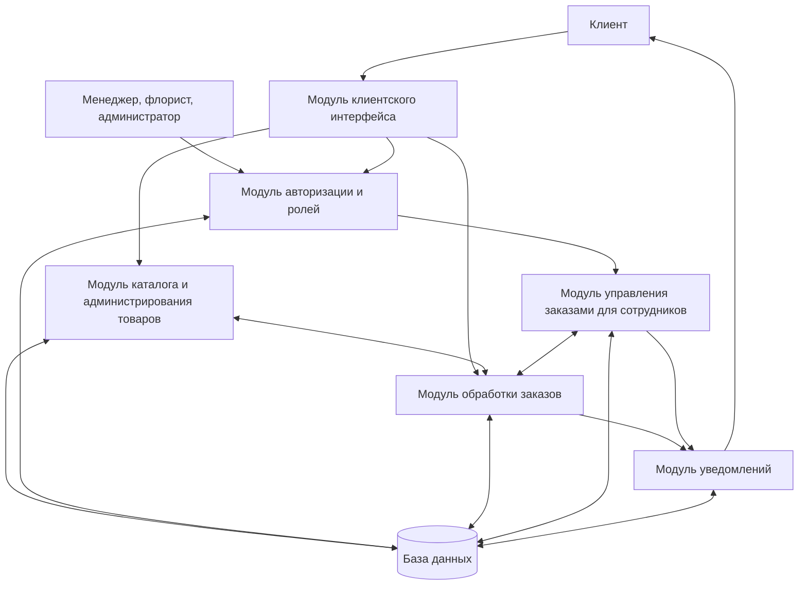

# Задание 4. Модель жизненного цикла и архитектура

## 7. Выбор модели жизненного цикла

Для веб-системы цветочной фермы «Эдельвейс» выбрана **итеративная модель**. Сначала разрабатываются базовые функции — каталог, корзина и оформление заказа. Затем добавляются личный кабинет, рабочие разделы сотрудников, уведомления и средства администрирования. После каждой итерации можно проверить промежуточный результат и уточнить требования к интерфейсу, статусам и действиям пользователей.

По сравнению с водопадной моделью итеративный подход позволяет дорабатывать требования после знакомства с прототипами. Для учебного проекта он проще полноценного Scrum: не требуется отдельно описывать спринты, регулярные встречи и роли команды.

| Итерация | Что разрабатывается | Результат |
| --- | --- | --- |
| 1 | Базовый каталог и регистрация пользователей | Структура сайта, регистрация и вход, просмотр ассортимента |
| 2 | Корзина и оформление заказа | Выбор товаров и способа получения, ввод контактов, расчёт суммы, создание заказа с уникальным номером |
| 3 | Обработка заказов сотрудниками | Просмотр и подтверждение заказов менеджером, передача флористу, изменение статусов и отметка готовности |
| 4 | Уведомления и личный кабинет | Сообщения о принятии и статусах заказа, история заказов клиента |
| 5 | Администрирование, проверка и улучшение | Управление каталогом и пользователями, проверка сценариев, исправление ошибок, доработка интерфейса |

## 8. Архитектура системы

Система разделена на связанные модули, каждый из которых отвечает за отдельные функции.

| Модуль | Назначение | Связанные компоненты |
| --- | --- | --- |
| Клиентский интерфейс | Просмотр каталога и карточек, корзина, оформление заказа и отслеживание статуса | Авторизация, каталог, обработка заказов, уведомления |
| Авторизация и роли | Регистрация, вход и разграничение прав клиента, менеджера, флориста, администратора | Клиентский интерфейс, рабочие разделы, каталог, база данных |
| Каталог и администрирование товаров | Отображение товаров, изменение названия, описания и цены, скрытие недоступных позиций | Клиентский интерфейс, обработка заказов, авторизация, база данных |
| Обработка заказов | Уникальный номер, сумма, способ получения, статусы заказа | Клиентский интерфейс, каталог, управление заказами сотрудниками, уведомления, база данных |
| Управление заказами для сотрудников | Работа менеджера с заказами, просмотр заданий и отметка готовности флористом | Авторизация, обработка заказов, уведомления, база данных |
| Уведомления | Сообщения о принятии, подтверждении, готовности, изменении статуса или отмене | Обработка заказов, рабочие разделы сотрудников, клиентский интерфейс, база данных |
| База данных | Хранение пользователей, товаров, заказов, статусов и уведомлений | Все модули, использующие сохраняемые сведения |

### Схема архитектуры

Схема передаёт общую структуру из рисунка 1 исходного задания 4: клиентский интерфейс, авторизация, каталог, обработка заказов, рабочий раздел сотрудников, уведомления и общая база данных.

*Основано на документе «Задание 4» прошлого семестра. В исходном Word-файле также имеется графическая схема архитектуры.*
