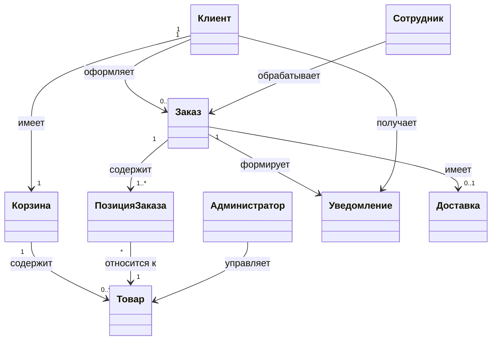
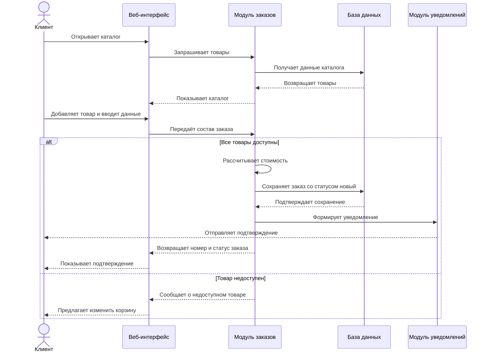

# Задание 5. UML-диаграммы и тест-кейсы

## UML-диаграмма классов

В системе выделены девять основных классов, отражающих работу клиента с каталогом, оформление заказа, действия сотрудников и отправку уведомлений.

| Класс | Атрибуты | Методы | Связи |
| --- | --- | --- | --- |
| Клиент | clientId, ФИО, телефон, адрес доставки, история заказов | оформитьЗаказ(), просмотретьСтатус(), отменитьЗаказ() | Имеет корзину, оформляет заказы, получает уведомления |
| Корзина | cartId, список товаров, итоговая сумма, дата обновления | добавитьТовар(), удалитьТовар(), рассчитатьСумму() | Принадлежит клиенту, содержит товары |
| Товар | productId, название, описание, цена, изображение, доступность | обновитьДанные(), скрыть(), показать() | Участвует в корзине и заказах; управляется администратором |
| Администратор | adminId, логин, роль, ФИО | добавитьТовар(), изменитьЦену(), управлятьПользователями() | Управляет товарами и пользователями |
| Заказ | orderId, дата создания, статус, итоговая сумма, способ получения, дата доставки | создать(), изменитьСтатус(), рассчитатьСтоимость() | Связан с клиентом, сотрудником, позициями, уведомлениями и доставкой |
| Позиция заказа | itemId, количество, цена товара на момент заказа | изменитьКоличество(), рассчитатьСтоимость() | Принадлежит заказу, относится к товару |
| Сотрудник | employeeId, ФИО, должность, права доступа | просмотретьЗаказы(), изменитьСтатус(), передатьФлористу() | Обрабатывает заказ |
| Уведомление | notificationId, тип, текст, дата отправки, статус отправки | сформировать(), отправить(), отметитьОтправленным() | Создаётся по заказу, направляется клиенту |
| Доставка | deliveryId, адрес, дата и время доставки, статус доставки | назначить(), изменитьСтатус(), подтвердитьВыдачу() | Предусмотрена при выборе доставки |

### Диаграмма классов

Основные связи: клиент имеет корзину и оформляет заказы; заказ содержит позиции, связанные с конкретными товарами; сотрудник обрабатывает заказ; администратор изменяет каталог; по заказу создаются уведомления; доставка предусмотрена не для каждого заказа.

## UML-диаграмма последовательности оформления заказа

Основной сценарий связан с каталогом, корзиной, расчётом стоимости, сохранением заказа и отправкой уведомления.

## Тест-кейсы

| № | Что проверяется | Входные данные | Действия | Ожидаемый результат |
| --- | --- | --- | --- | --- |
| 1 | Успешное оформление заказа | Клиент выбран в системе, товары доступны, указаны имя, телефон, адрес и дата доставки | Добавить товар, заполнить форму, оформить заказ | Заказ создан, сохранён в базе, присвоен номер и показано подтверждение |
| 2 | Расчёт итоговой стоимости | Несколько товаров разной цены, выбрана доставка | Открыть корзину и перейти к оформлению | Сумма учитывает количество товаров и доставку |
| 3 | Пустой номер телефона | Заполнена форма без номера телефона | Нажать кнопку оформления | Заказ не создан; система запрашивает телефон |
| 4 | Недоступный товар в корзине | Товар добавлен, но позднее стал недоступен | Попытаться оформить заказ | Появляется сообщение с предложением удалить или заменить товар |
| 5 | Просмотр заказа менеджером | Есть заказ со статусом «новый» | Авторизоваться менеджером, открыть список заказов | Отображаются сведения о клиенте, составе, дате и статусе |
| 6 | Изменение статуса заказа | Подтверждённый заказ передан в работу | Изменить статус на «в работе», затем «готов» | Статусы сохранены и отображаются в карточке |
| 7 | Отправка уведомления клиенту | Менеджер подтвердил заказ | Система формирует уведомление | Клиент получает номер и актуальный статус заказа |
| 8 | Добавление товара администратором | Администратор вошёл в систему, подготовлены название, описание, цена и изображение | Добавить позицию в каталоге и сохранить | Новый товар появляется в каталоге и доступен клиентам |

Диаграммы и тесты проверяют ранее описанные требования: оформление заказа, вычисление стоимости, работу менеджера и флориста, отправку уведомлений и действия администратора.

*Основано на документе «Задание 5» прошлого семестра. Диаграммы представлены в Markdown/Mermaid для просмотра на GitHub; в исходном Word-документе находятся оригинальные рисунки.*
